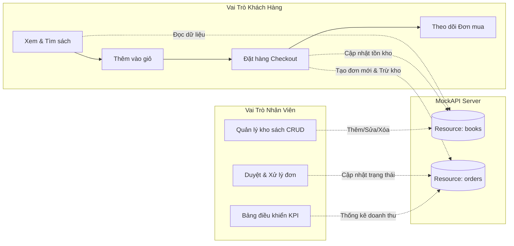
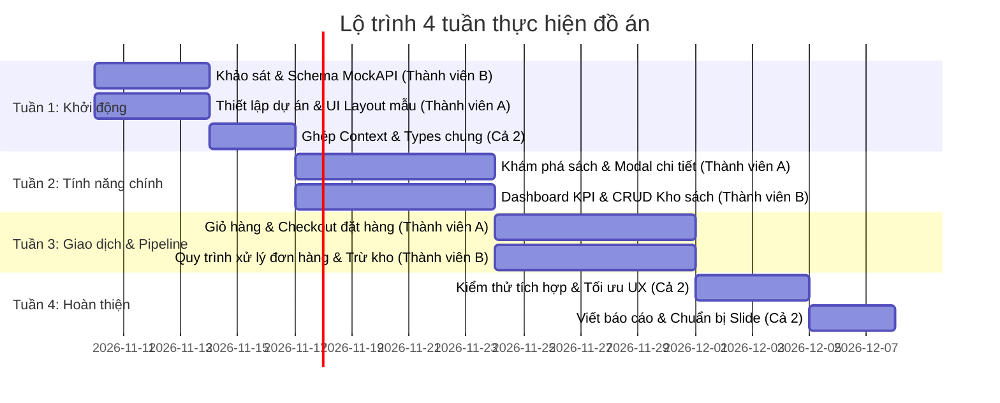

# Kế Hoạch & Phân Công Nhiệm Vụ Đồ Án: Ứng Dụng BookStore Mobile

> **Đề tài:** Xây dựng ứng dụng di động mua sắm và quản lý nhà sách (BookStore)  
> **Nền tảng:** React Native (Expo) + TypeScript + MockAPI  
> **Quy mô nhóm:** 2 sinh viên (Thành viên A & Thành viên B)  
> **Thời gian dự kiến:** 4 tuần (4 Sprints)

---

## 1. Mục Tiêu Đồ Án & Điểm Nhấn Nghiệp Vụ

Dự án mô phỏng trọn vẹn luồng kinh doanh của một nhà sách hiện đại với **2 vai trò tách biệt**:
1. **Khách hàng (Customer):** Trải nghiệm mua sắm mượt mà, tìm kiếm sách nhanh, lọc theo danh mục, xem chi tiết, giỏ hàng, đặt hàng thanh toán và theo dõi đơn mua.
2. **Nhân viên cửa hàng (Store Staff):** Bảng điều khiển kinh doanh (KPIs), quản lý kho sách (thêm, sửa, xóa, theo dõi tồn kho) và xử lý quy trình đơn hàng (Duyệt đơn ➔ Giao hàng ➔ Hoàn tất).



---

## 2. Ma Trận Phân Chia Trách Nhiệm (Phân Công 50 - 50)

Để đảm bảo khối lượng công việc công bằng và dễ báo cáo khi giảng viên vấn đáp, nhóm chia thành 2 phân hệ rõ ràng:

### 👤 Thành Viên A: Lead Phân Hệ Khách Hàng (Customer Experience)
*Mục tiêu:* Đảm bảo trải nghiệm mua hàng nhanh chóng, tiện dụng, giao diện trực quan và quy trình thanh toán chính xác.

| STT | Module / Chức năng | Nội dung công việc chi tiết | Sản phẩm bàn giao (Deliverables) |
| :---: | :--- | :--- | :--- |
| **A1** | **Trang chủ & Khám phá sách** | • Thanh tìm kiếm realtime theo tên sách, tác giả<br>• Bộ lọc danh mục sách (Category Chips)<br>• Sắp xếp sách theo giá, độ phổ biến, đánh giá<br>• Mục "Sách nổi bật" (Bestsellers) | `CustomerHomeScreen.tsx`, `CategoryChips.tsx` |
| **A2** | **Thẻ sách & Chi tiết sách** | • Hiển thị ảnh bìa, giá bán, giá niêm yết, tồn kho, sao đánh giá<br>• Modal chi tiết sách: mô tả nội dung, điều chỉnh số lượng mua (- / +)<br>• Nút "Thêm vào giỏ" và "Mua ngay" | `BookCard.tsx` (Customer mode), `BookDetailModal.tsx` |
| **A3** | **Giỏ hàng & Tính toán** | • Nút giỏ hàng nổi (Floating Cart FAB) kèm badge số lượng<br>• Modal giỏ hàng: tăng/giảm số lượng, xóa sản phẩm khỏi giỏ<br>• Logic tự động tính tổng tiền & miễn phí vận chuyển ($\ge 200.000$ đ) | `CartModal.tsx`, `FloatingCartButton.tsx` |
| **A4** | **Thanh toán & Đặt hàng** | • Form thông tin nhận hàng: Họ tên, SĐT, Địa chỉ, Ghi chú<br>• Chọn phương thức thanh toán: COD, Chuyển khoản, MoMo<br>• Kiểm tra hợp lệ dữ liệu (validation) và gọi hàm tạo đơn | `CheckoutModal.tsx` |
| **A5** | **Đơn mua & Tài khoản khách** | • Tab "Đơn mua": Lịch sử mua hàng, trạng thái trực quan<br>• Chức năng hủy đơn hàng khi đơn còn đang "Chờ xác nhận"<br>• Tab "Tài khoản": Thông tin cá nhân, địa chỉ, lối vào bảo mật nhân viên | `OrderHistoryScreen.tsx`, `AccountScreen.tsx` |

---

### 👔 Thành Viên B: Lead Phân Hệ Quản Trị & API (Staff & Core Architecture)
*Mục tiêu:* Đảm bảo backend MockAPI hoạt động thông suốt, luồng nghiệp vụ kho/đơn hàng khép kín và giao diện quản trị đầy đủ số liệu.

| STT | Module / Chức năng | Nội dung công việc chi tiết | Sản phẩm bàn giao (Deliverables) |
| :---: | :--- | :--- | :--- |
| **B1** | **Kiến trúc Data & MockAPI** | • Khởi tạo & cấu hình 2 resource `books` và `orders` trên MockAPI<br>• Xây dựng tầng service gọi API (GET, POST, PUT, DELETE)<br>• Xử lý timeout, chuẩn hóa URL (`cleanUrl`), cơ chế **Offline Fallback** | `src/services/mockapi.ts`, `src/config/api.ts` |
| **B2** | **Quản lý State toàn cục** | • Thiết lập Context API lưu trữ danh sách sách, giỏ hàng, đơn hàng, vai trò<br>• Viết các hàm nghiệp vụ: cập nhật tồn kho sau khi mua, thêm/sửa/xóa sách, đổi trạng thái đơn | `src/context/AppContext.tsx`, `src/types/index.ts` |
| **B3** | **Bảng điều khiển (Dashboard)** | • Thống kê 4 thẻ chỉ số KPI: Doanh thu thực tế, Số đơn chờ duyệt, Tổng đầu sách, Số lượng sách sắp hết hàng ($\le 5$ cuốn)<br>• Danh sách đơn hàng mới cần duyệt ngay | `StaffDashboardScreen.tsx` |
| **B4** | **Quản lý kho sách (CRUD)** | • Danh sách sách quản trị kèm số lượng tồn và trạng thái cảnh báo<br>• Modal Form: Thêm sách mới & Chỉnh sửa thông tin sách (có preview ảnh bìa trực tiếp)<br>• Xóa sách với hộp thoại xác nhận an toàn | `StaffBooksScreen.tsx`, `BookFormModal.tsx` |
| **B5** | **Quy trình xử lý đơn hàng & Bảo mật** | • Quản lý pipeline đơn hàng: *Chờ xác nhận ➔ Đang xử lý ➔ Đang giao ➔ Hoàn tất*<br>• Nút 1-chạm duyệt đơn, giao hàng, hoàn tất, hủy đơn<br>• Cơ chế bảo mật: Đăng nhập mã PIN nhân viên (`1234`) | `StaffOrdersScreen.tsx`, Header Staff mode |

---

## 3. Lộ Trình Thực Hiện 4 Tuần (Sprints Timeline)



### Tuần 1: Khảo sát, Thiết lập & Khung sườn kiến trúc
- **Mục tiêu chung:** Dự án khởi chạy được trên cả thiết bị di động (Expo Go) và Web, có MockAPI hoạt động.
- **Thành viên A:**
  - Lập dàn ý UI/UX theo chuẩn Mobile-First.
  - Tạo cấu trúc thư mục, Header, Bottom Tab Bar và bảng màu chủ đạo (Primary Blue, Coral, Neutral Slate).
- **Thành viên B:**
  - Tạo project trên `mockapi.io`, tạo 2 resource `books` và `orders`.
  - Khởi tạo file cấu hình `src/config/api.ts` và file types `src/types/index.ts`.
  - Viết tầng gọi API ban đầu với dữ liệu seed sẵn.
- **Kết quả nghiệm thu cuối tuần 1:** App hiển thị được Header, Bottom Bar và kết nối thử thành công MockAPI.

### Tuần 2: Trải nghiệm xem sách (Khách) & Quản lý kho (Nhân viên)
- **Thành viên A (Khách hàng):**
  - Hoàn thiện `CustomerHomeScreen`: Ô tìm kiếm từ khóa, thanh lọc thể loại (CategoryChips).
  - Hoàn thiện component `BookCard` hiển thị ảnh bìa, giá tiền, rating.
  - Làm `BookDetailModal`: popup chi tiết sách, số lượng mua, mô tả.
- **Thành viên B (Nhân viên):**
  - Làm `StaffDashboardScreen`: thẻ KPI thống kê doanh thu, cảnh báo sách tồn kho thấp.
  - Làm `StaffBooksScreen`: danh sách kho sách quản lý.
  - Làm `BookFormModal`: form thêm và sửa sách với xem trước link ảnh bìa.
- **Kết quả nghiệm thu cuối tuần 2:** Khách hàng xem và tìm kiếm được sách; Nhân viên thêm, sửa, xóa được sách trên MockAPI.

### Tuần 3: Giỏ hàng - Đặt hàng & Quy trình xử lý đơn
- **Thành viên A (Khách hàng):**
  - Làm `CartModal`: thêm sách, tăng giảm số lượng, xóa sách, tính tiền ship.
  - Làm `CheckoutModal`: form điền tên, SĐT, địa chỉ, chọn thanh toán COD/Chuyển khoản/MoMo.
  - Làm `OrderHistoryScreen`: hiển thị danh sách đơn khách đã đặt và nút hủy đơn.
- **Thành viên B (Nhân viên):**
  - Viết logic tự động trừ số lượng sách tồn kho (`stock`) trong MockAPI ngay khi khách đặt hàng thành công.
  - Làm `StaffOrdersScreen`: bộ lọc trạng thái đơn, các nút duyệt đơn, giao hàng, hoàn tất.
  - Cài đặt modal nhập mã PIN bảo mật (`1234`) để vào chế độ nhân viên.
- **Kết quả nghiệm thu cuối tuần 3:** Luồng mua bán khép kín: Khách đặt đơn ➔ Tồn kho trừ ➔ Nhân viên duyệt và đổi trạng thái ➔ Khách thấy trạng thái mới.

### Tuần 4: Kiểm thử, Tối ưu & Chuẩn bị Báo cáo Đồ án
- **Cả 2 thành viên:**
  - Test luồng ngoại tuyến (Offline fallback): Tắt mạng xem ứng dụng có bị văng lỗi không (đảm bảo 100% không crash).
  - Chạy kiểm tra TypeScript (`npx tsc --noEmit`) đạt 0 lỗi.
  - Rà soát xóa toàn bộ chữ thừa, console.log thừa.
  - **Phân công phần viết báo cáo đồ án:**
    - Thành viên A: Viết chương 1 (Giới thiệu bài toán, Khảo sát nghiệp vụ) + Chương 3 (Thiết kế giao diện phía khách hàng, kịch bản người dùng).
    - Thành viên B: Viết chương 2 (Kiến trúc hệ thống, Biểu đồ luồng dữ liệu, Thiết kế API/Database) + Chương 4 (Phân hệ quản trị, Đánh giá kết quả & Hướng phát triển).
    - Cả 2: Cùng làm Slide thuyết trình và quay video demo (nếu giảng viên yêu cầu).

---

## 4. Quy Ước Làm Việc Nhóm Qua Git (Tránh Xung Đột Mã Nguồn)

Để hai bạn code cùng nhau trên GitHub mà không bị đè code (conflict):

1. **Quy tắc chia nhánh (Branching strategy):**
   - Nhánh `main`: Chỉ chứa code đã chạy ổn định và được test kỹ.
   - Nhánh của Thành viên A: `feature/customer-flow`
   - Nhánh của Thành viên B: `feature/staff-flow`
2. **Quy trình commit hàng ngày:**
   ```bash
   # Bước 1: Lấy code mới nhất về trước khi code
   git checkout main
   git pull origin main

   # Bước 2: Chuyển về nhánh của mình để làm việc
   git checkout feature/customer-flow
   git merge main

   # Bước 3: Sau khi hoàn thành chức năng thì commit rõ nghĩa
   git add .
   git commit -m "feat(customer): hoan thien modal gio hang va checkout"
   git push origin feature/customer-flow
   ```
3. **Quy ước đặt tên commit (Conventional Commits):**
   - `feat:` Khi thêm chức năng mới (VD: `feat(staff): them chuc nang sua sach`)
   - `fix:` Khi sửa lỗi (VD: `fix(cart): sua loi tinh sai phi ship`)
   - `style:` Khi chỉnh sửa giao diện, màu sắc, font chữ
   - `docs:` Khi cập nhật tài liệu README hoặc báo cáo

---

## 5. Điểm Cộng & Chiến Lược Trả Lời Khi Vấn Đáp Trước Hội Đồng

Khi bảo vệ đồ án trước giảng viên, các bạn nên nhấn mạnh các điểm mạnh sau:

1. **Khép kín luồng nghiệp vụ thực tế (End-to-End Business Cycle):**  
   *Giải thích:* Không làm các màn hình rời rạc, mà việc Khách đặt hàng sẽ tác động trực tiếp lên Tồn kho của phân hệ Nhân viên và đưa vào hàng đợi duyệt đơn của Nhân viên.
2. **Cơ chế chịu lỗi ngoại tuyến (Offline Fallback & Error Resilience):**  
   *Giải thích:* Hệ thống có tầng trung gian thông minh, nếu MockAPI bị giới hạn lượt gọi hoặc mất kết nối mạng, ứng dụng tự động chuyển sang dữ liệu bộ nhớ đệm, đảm bảo không bao giờ bị đứng màn hình hoặc crash ứng dụng trước mặt thầy cô.
3. **Giao diện phân quyền tinh tế (Discreet Role-based Access):**  
   *Giải thích:* Giao diện khách hàng hoàn toàn sạch sẽ như app Shopee/Tiki thật, không phơi bày các nút admin thô sơ, mà chỉ có thể truy cập phân hệ quản lý thông qua mã định danh bảo mật tại trang tài khoản.
4. **Codebase TypeScript 100% Type-Safe:**  
   *Giải thích:* Toàn bộ các đối tượng Sách, Giỏ hàng, Đơn hàng đều được định nghĩa interface chặt chẽ, kiểm thử `npx tsc --noEmit` đạt 0 lỗi, dễ mở rộng và bảo trì.
